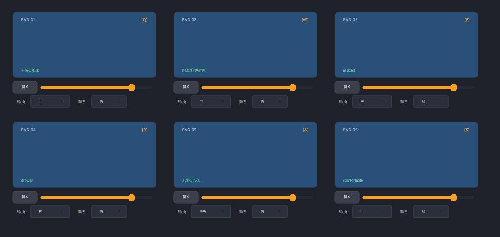
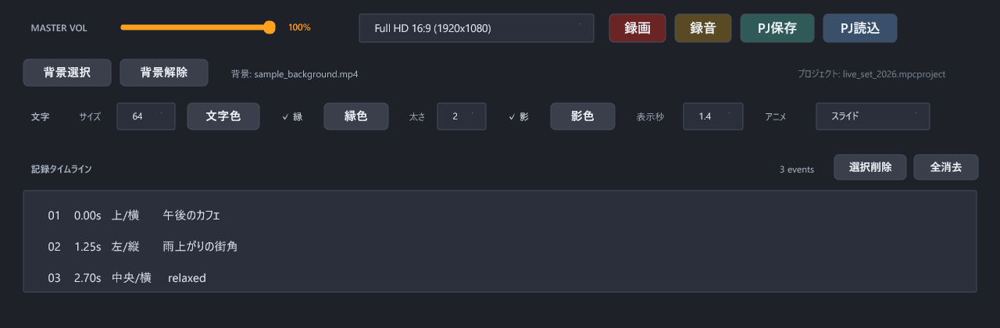
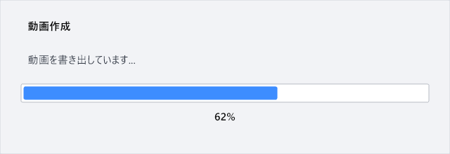

# 画面紹介用画像

操作マニュアル用に用意した画面画像です。現在の実行画面とは表示が異なる場合があります。

## PAD操作

音源を割り当てたPADと、音量・文字の表示場所・表示向きの設定を紹介する画像です。

## 録画・文字設定・タイムライン

録画・録音、プロジェクト保存・読込、背景選択、文字スタイル、記録タイムラインを紹介する画像です。

## 書き出し進捗

動画の書き出し中に表示する進捗画面の紹介用画像です。

